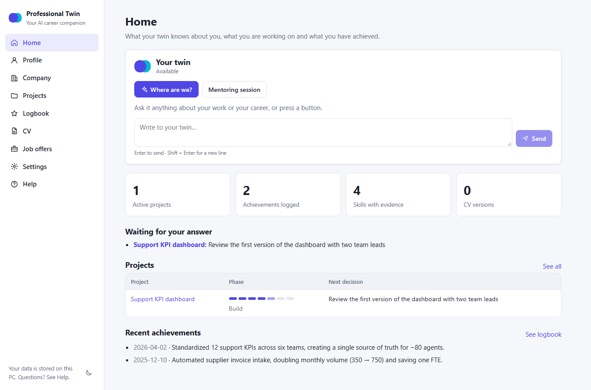
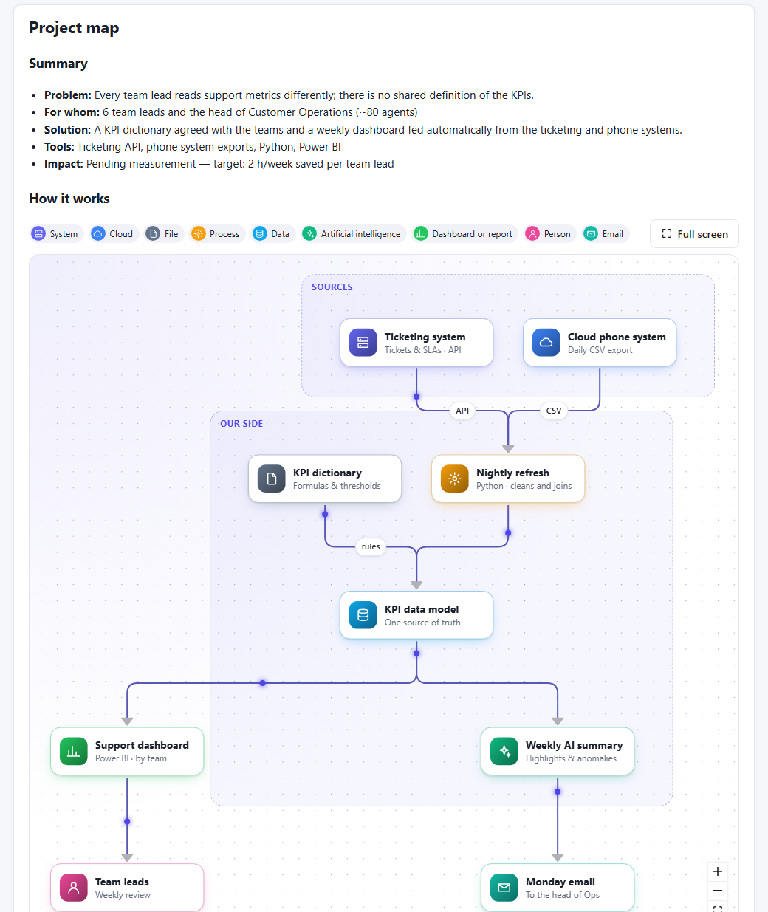
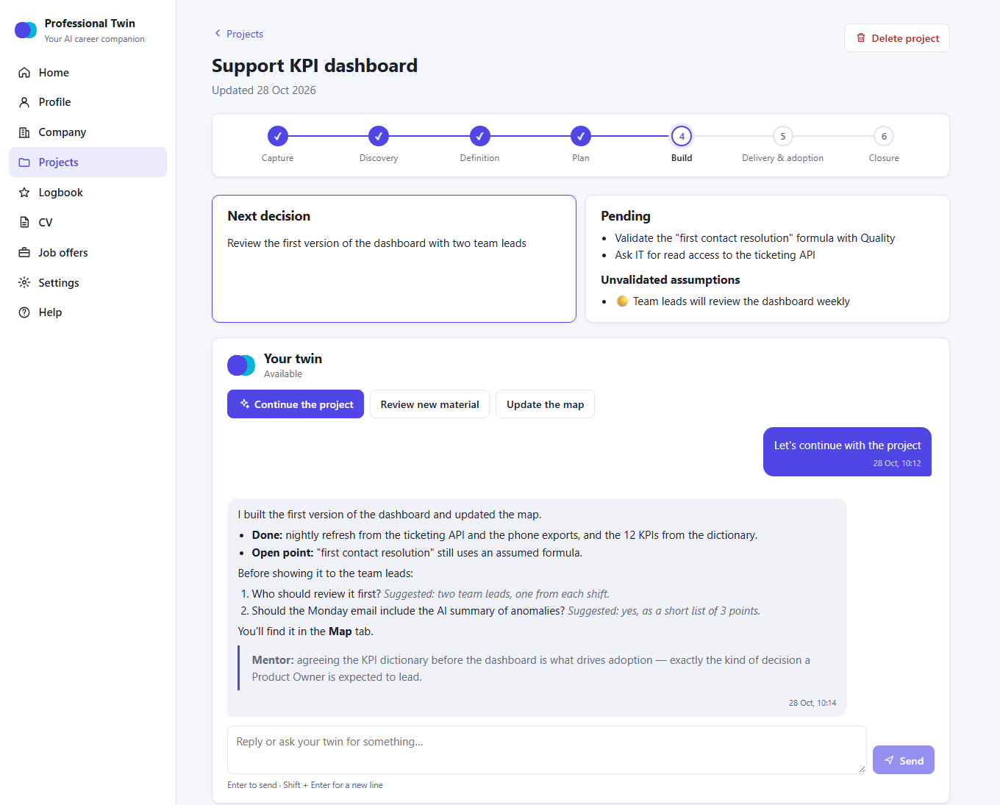
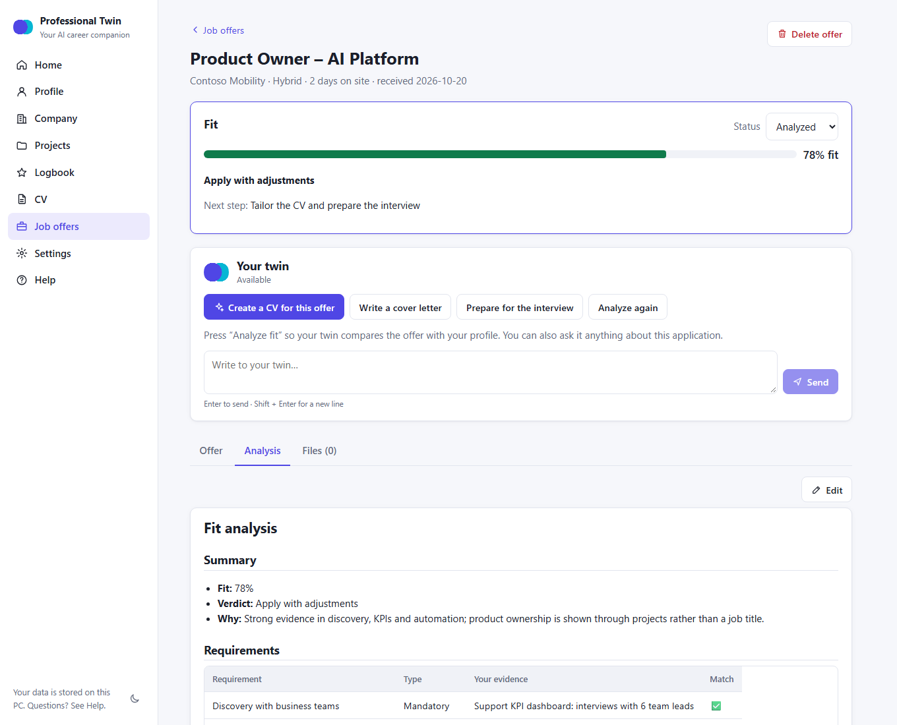
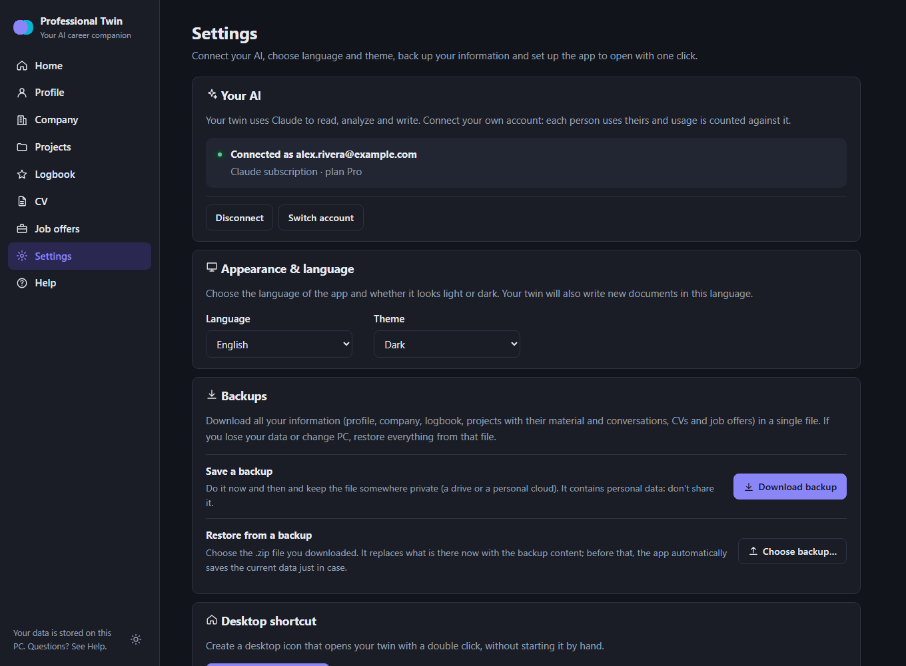
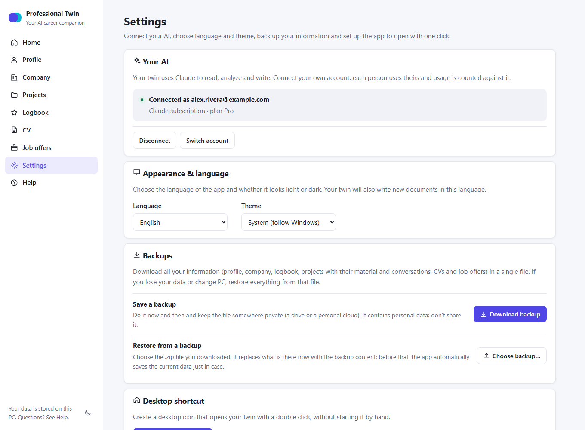

<div align="center">

# Professional Twin · Gemelo profesional

**Un framework de gemelo profesional con IA, construido sobre Claude Code.**

Conoce tu experiencia, aplica tus criterios y te acompaña desde una necesidad de negocio hasta la solución entregada,
mientras convierte todo lo que haces en evidencia para tu CV y tu plan de carrera.

[](LICENSE)


[English](README.md) · [Español](README.es.md)

**▶ Recorrido interactivo:** [maibp.github.io/professional-twin](https://maibp.github.io/professional-twin/)

<a href="https://www.buymeacoffee.com/TU_USUARIO" target="_blank"></a>

</div>



> Las capturas muestran la interfaz en inglés (idioma por defecto) con datos ficticios. Puedes cambiarla a español en **Settings → Appearance & language**.

---

## Índice

- [Qué es](#qué-es)
- [Qué hace](#qué-hace)
- [Cómo funciona](#cómo-funciona)
- [Privacidad](#privacidad)
- [Requisitos](#requisitos)
- [Instalación](#instalación)
- [Conectar tu IA (Claude Code)](#conectar-tu-ia-claude-code)
- [Uso diario](#uso-diario)
- [Uso desde la terminal](#uso-desde-la-terminal)
- [Copias de seguridad](#copias-de-seguridad)
- [Migrar desde gemelo-profesional](#migrar-desde-gemelo-profesional)
- [Estructura](#estructura)
- [Personalizar y ampliar](#personalizar-y-ampliar)
- [Contribuir](#contribuir) · [Licencia](#licencia) · [Apoyar el proyecto](#apoyar-el-proyecto)

## Qué es

Professional Twin es un espacio privado y local que convierte [Claude Code](https://claude.com/claude-code) en **tu gemelo profesional**. Cumple tres roles a la vez:

| Rol | Qué hace por ti |
|---|---|
| 🤝 **Compañero de trabajo** | Analiza necesidades, planifica, documenta y construye prototipos, código, paneles y presentaciones. |
| 🧭 **Mentor** | Cuestiona con buenas prácticas, señala riesgos y muestra cómo lo haría alguien un nivel por encima. |
| 📝 **Cronista de carrera** | Registra cada logro con evidencia para que tu CV y tu plan de carrera se construyan solos. |

Incluye una **app web** pensada para personas no técnicas: sin comandos ni prompts, solo botones, formularios y un chat. Quien prefiera la terminal puede usar el mismo gemelo desde ahí.

## Qué hace

- **Perfil a partir de tu CV.** Subes tu CV y certificados; el gemelo los lee y completa tu perfil, tu forma de trabajar y tus objetivos con una entrevista breve.
- **De la necesidad al producto.** Cuentas un problema con tus palabras; el gemelo abre un proyecto y lo lleva por siete fases: hace las preguntas de un buen consultor, propone una solución y la construye contigo. Nada avanza sin tu aprobación.
- **Documentar trabajos pasados.** Le indicas una carpeta (o subes archivos) de algo que ya hiciste; analiza el material y arma el mapa y la ficha del proyecto para tu portafolio.
- **Mapas de proyecto interactivos.** Cada proyecto tiene una ficha y un diagrama de arquitectura interactivo (zoom, clic en cada pieza para ver su detalle, flujos animados), exportable a **PDF**.
- **Bitácora de logros → CV.** Los logros se redactan como acción + resultado, con habilidades, herramientas y evidencia. Genera CV a medida (Markdown + PDF) para un puesto u oferta.
- **Ofertas de empleo.** Pegas una oferta y obtienes el porcentaje de encaje, las brechas, cómo presentarte con honestidad, un CV y una carta a medida y preparación de entrevista. Sigues el estado de cada candidatura.
- **Mentoría.** Sesiones de carrera que revisan tu avance frente al rol objetivo y actualizan tu plan.
- **Inglés o español, modo claro u oscuro.** Ambos se cambian en *Configuración*.

<table>
<tr>
<td width="50%"><br><sub><b>Mapa del proyecto</b>: ficha + diagrama interactivo</sub></td>
<td width="50%"><br><sub><b>Tu gemelo</b>: botones y chat, progreso en vivo</sub></td>
</tr>
<tr>
<td width="50%"><br><sub><b>Ofertas</b>: encaje, brechas y candidatura a medida</sub></td>
<td width="50%"><br><sub><b>Configuración</b>: tu IA, idioma y tema (modo oscuro), copias</sub></td>
</tr>
</table>

## Cómo funciona

El gemelo tiene dos partes que trabajan sobre **los mismos archivos Markdown** de tu ordenador:

- **El cerebro: Claude Code.** Entiende, pregunta, propone, construye y registra. Su identidad y su método están en [`CLAUDE.md`](CLAUDE.md) y sus capacidades en [`.claude/skills/`](.claude/skills).
- **La ventana: una app web local.** Muestra tu perfil, proyectos, bitácora y CV; permite subir y editar con formularios, y ejecuta el cerebro por ti en segundo plano cuando pulsas un botón o escribes en el chat.

<picture>
  <source media="(prefers-color-scheme: dark)" srcset="docs/images/how-it-works-es-dark.svg">
  
</picture>

### El recorrido de un proyecto

<picture>
  <source media="(prefers-color-scheme: dark)" srcset="docs/images/journey-es-dark.svg">
  
</picture>

### Qué pasa cuando pulsas un botón

<picture>
  <source media="(prefers-color-scheme: dark)" srcset="docs/images/what-happens-es-dark.svg">
  
</picture>

## Privacidad

La privacidad es un principio de diseño, no un añadido.

<picture>
  <source media="(prefers-color-scheme: dark)" srcset="docs/images/privacy-es-dark.svg">
  
</picture>

- **Tu contenido nunca va a git.** Las carpetas privadas están en `.gitignore`; el código que clonas solo trae plantillas vacías.
- **Servidor solo local.** La app escucha en `127.0.0.1` (no es accesible desde otras máquinas), solo lee y escribe en tus carpetas privadas y exige una cabecera propia en cada escritura.
- **Qué llega a la IA.** Cuando el gemelo trabaja en una tarea, Claude Code envía a Claude (Anthropic) el contenido que necesita leer para procesarlo, igual que cuando usas Claude directamente, **con tu propia cuenta y sus condiciones**. Antes de subir material de tu empresa, quita los datos personales de clientes o empleados que no hagan falta.
- **La app no guarda credenciales.** El inicio de sesión lo gestiona Claude Code.
- **Usa tu propia cuenta.** Si tu cuenta de Claude es de tu empresa, valora conectar una personal para el contenido de carrera (CV, ofertas).
- **Límites del gemelo.** Nunca inventa logros, cifras ni certificaciones, no ejecuta scripts que vengan en tu material y deja fuera los datos personales innecesarios en los entregables para otras personas.

## Requisitos

| Herramienta | Para qué | Dónde |
|---|---|---|
| **Node.js 20+** | Ejecutar la app local | [nodejs.org](https://nodejs.org) |
| **Git** | Descargar el proyecto (o bajar el ZIP desde GitHub) | [git-scm.com](https://git-scm.com) |
| **Claude Code** | El cerebro del gemelo | [claude.com/claude-code](https://claude.com/claude-code) |
| **Una cuenta de Claude** | Suscripción Claude Pro, Max, Team o Enterprise, *o* cuenta de Anthropic Console (pago por uso) | [claude.ai](https://claude.ai) · [console.anthropic.com](https://console.anthropic.com) |
| **Microsoft Edge o Google Chrome** | Exportar a PDF los CV y los mapas | suelen venir instalados |

Funciona en Windows (con acceso directo de escritorio), macOS y Linux.

## Instalación

```bash
git clone https://github.com/MaiBP/professional-twin.git
cd professional-twin
npm install
npm run init          # crea tus carpetas privadas desde las plantillas (nunca sobrescribe)
npm start             # compila la interfaz y abre la app en http://localhost:3210
```

**Windows, sin terminal:** doble clic en `start.bat`. Después, en la app, ve a **Configuración → Acceso directo** para tener un icono en el escritorio que abre la app con doble clic.

## Conectar tu IA (Claude Code)

1. Instala Claude Code ([instrucciones](https://claude.com/claude-code)).
2. Abre la app → **Configuración → Tu IA** → **Conectar**.
3. Elige *Suscripción de Claude* o *Anthropic Console*. Se abre una página de Claude en el navegador: inicia sesión, autoriza, copia el código que te muestra y pégalo en la app.

Listo: el estado se pone en verde y se activan todos los botones del gemelo. Desde ahí mismo puedes **cambiar de cuenta** o **desconectar**. Cada tarea consume el uso de tu cuenta (una respuesta rápida cuesta céntimos; documentar un proyecto grande, más).



> ¿Prefieres la terminal? `claude auth login` hace lo mismo y `claude auth status` muestra la cuenta conectada.

## Uso diario

1. **La primera vez:** en *Perfil → CV y certificados*, sube tu CV y pulsa *Completar o actualizar mi perfil*. Responde la entrevista breve del gemelo.
2. **Una necesidad nueva:** en *Proyectos → Contar una necesidad*, cuéntale el problema con tus palabras. Te responde con lo que entendió y una primera tanda de preguntas, cada una con una respuesta sugerida: contesta `ok` o corrige.
3. **Un trabajo pasado:** en *Proyectos → Documentar un proyecto ya hecho*, indica la ruta de las carpetas o sube archivos y pulsa *Crear y analizar*.
4. **Seguir:** pulsa *Seguir con el proyecto* y aprueba cada fase. Mira la pestaña **Mapa** (y descárgala en PDF).
5. **Carrera:** los logros llegan solos a la **Bitácora**; crea CV en **CV**; pega ofertas en **Ofertas**; pide una sesión de mentoría en **Perfil**.

El gemelo pregunta en tandas de 3 a 6 preguntas, siempre con una respuesta sugerida, distingue lo que sabe, lo que supone y lo que falta, y nunca cierra una fase sin tu aprobación explícita.

## Uso desde la terminal

Todo lo que hace la app se puede hacer directamente con Claude Code. Abre una terminal **en la carpeta del proyecto** (para que se carguen `CLAUDE.md` y las skills) y ejecuta:

```bash
cd professional-twin
claude
```

| Comando | Qué hace |
|---|---|
| `/onboarding` | Construir o actualizar tu perfil a partir de tu CV, certificados y contexto de empresa |
| `/need <descripción>` | Capturar una necesidad de negocio y abrir un proyecto |
| `/document <proyecto o carpeta>` | Dar de alta un proyecto ya terminado (retrospectivo), con su mapa |
| `/advance` | Llevar el proyecto activo a su siguiente paso o fase |
| `/log <lo que hiciste>` | Anotar un logro a mano |
| `/mentor` | Sesión de mentoría y revisión del plan de carrera |
| `/cv <puesto u oferta>` | Generar un CV a medida (Markdown + PDF) |
| `/offer <texto o enlace de la oferta>` | Analizar una oferta y preparar CV, carta y entrevista |
| `/status` | Resumen de proyectos, decisiones pendientes y logros recientes |

No siempre hacen falta comandos: háblale con normalidad, en español si quieres, y aplica el mismo método.

Scripts de npm útiles:

| Script | Para qué |
|---|---|
| `npm start` | Compilar la interfaz y arrancar la app en http://localhost:3210 |
| `npm run open` | Arrancar la app en segundo plano si hace falta y abrir el navegador |
| `npm run dev` | Modo desarrollo con recarga en caliente |
| `npm run init` | Crear los archivos privados que falten desde las plantillas |
| `npm run migrate -- <carpeta antigua>` | Importar un espacio de la versión anterior con nombres en español (ver abajo) |
| `npm run pdf -- <archivo.md>` | Convertir un Markdown (CV, carta) en un PDF limpio |

## Copias de seguridad

Tu contenido vive solo en tu PC: respáldalo. **Configuración → Copias de seguridad → Descargar copia** te da un único `.zip` con todo (perfil, empresa, bitácora, proyectos con su material y conversaciones, CV, ofertas) y un `README` dentro que explica cómo restaurarlo.

Para recuperarlo (tras perder datos o en un PC nuevo): **Configuración → Restaurar desde una copia**, elige el `.zip` y confirma. Antes de sustituir nada, la app guarda una copia automática del estado actual, así que una restauración se puede deshacer. Guarda las copias en un lugar privado: contienen datos personales. También se pueden restaurar copias hechas con la versión anterior con nombres en español: se convierten solas a los nombres nuevos.

## Migrar desde gemelo-profesional

Professional Twin antes se llamaba *gemelo-profesional* y usaba nombres de carpetas y archivos en español. Si tienes un espacio de esa versión, clona este repositorio en una carpeta nueva e impórtalo:

```bash
npm run migrate -- <ruta-a-tu-carpeta-gemelo-profesional>
```

- **Copia** tu perfil, el contexto de empresa, la bitácora, los proyectos, los CV, las ofertas y tus ajustes en la carpeta nueva, con los nombres nuevos en inglés, y convierte los mapas de proyecto y las conversaciones al formato nuevo.
- **Nunca modifica ni borra** nada de la carpeta antigua: consérvala hasta comprobar el resultado.
- No sobrescribe el contenido que ya tengas en la carpeta nueva salvo que añadas `--force`.
- El historial de conversaciones se conserva y se ve en la app, pero las sesiones de chat de Claude empiezan de cero (estaban ligadas a la carpeta antigua).

## Estructura

```
app/server/        API local (Express): archivos, ejecución del gemelo, ajustes, copias, PDF
app/client/        interfaz web (React + Vite); secciones registradas en src/sections.jsx
.claude/skills/    las capacidades del gemelo (una carpeta por comando)
templates/en|es/   plantillas vacías en inglés y en español
scripts/           init, abrir la app, Markdown → PDF, migración
docs/              imágenes del README y recorrido interactivo (GitHub Pages)
CLAUDE.md          identidad, método y reglas del gemelo
start.bat          lanzador para Windows

profile/ context/ journal/ projects/ cv/ offers/ backups/ settings.json   ← privados, fuera de git
```

> Los nombres de carpetas, archivos y comandos están en inglés. La interfaz, el gemelo y el contenido de tus archivos pueden estar en español: elige el idioma en **Configuración** y las plantillas en español se usan automáticamente (`templates/es/`).

## Personalizar y ampliar

- **¿Pregunta demasiado o muy poco?** Edita *How to ask* en `CLAUDE.md`.
- **¿Otras fases o documentos?** Edita `templates/<idioma>/project/` y `.claude/skills/advance/SKILL.md`. Si cambias el formato de `status.md`, `achievements.md`, `offer.md` o el bloque ```map de `map.md`, revisa `app/server/parsers.mjs`.
- **Una capacidad nueva:** añade `.claude/skills/<nombre>/SKILL.md`, su acción en `app/server/twin.mjs` y en el panel del gemelo de la página, y una entrada en `app/client/src/commands.js`.
- **El recorrido interactivo y los diagramas:** GitHub Pages publica el sitio desde la carpeta `/docs` de la rama principal (`docs/index.html`); los diagramas del README son los SVG de `docs/images/`.
- **Una sección nueva:** crea la página en `app/client/src/` y regístrala en `app/client/src/sections.jsx`; aparece sola en el menú.
- **Para otra persona:** clona, `npm install`, `npm run init` y conecta su propia cuenta de Claude. El contenido de nadie viaja con el código.

## Contribuir

Issues y pull requests son bienvenidos. Nunca incluyas contenido personal (nada de las carpetas privadas) en issues, capturas o PR.

## Licencia

[MIT](LICENSE) © 2026 Maira Pajaro

## Apoyar el proyecto

Si Professional Twin te ayuda a crecer profesionalmente, puedes invitarme a un café ☕

<a href="https://www.buymeacoffee.com/TU_USUARIO" target="_blank"></a>

<sub>Professional Twin es un proyecto independiente de código abierto, sin relación ni respaldo de Anthropic. Claude y Claude Code son productos de Anthropic.</sub>
