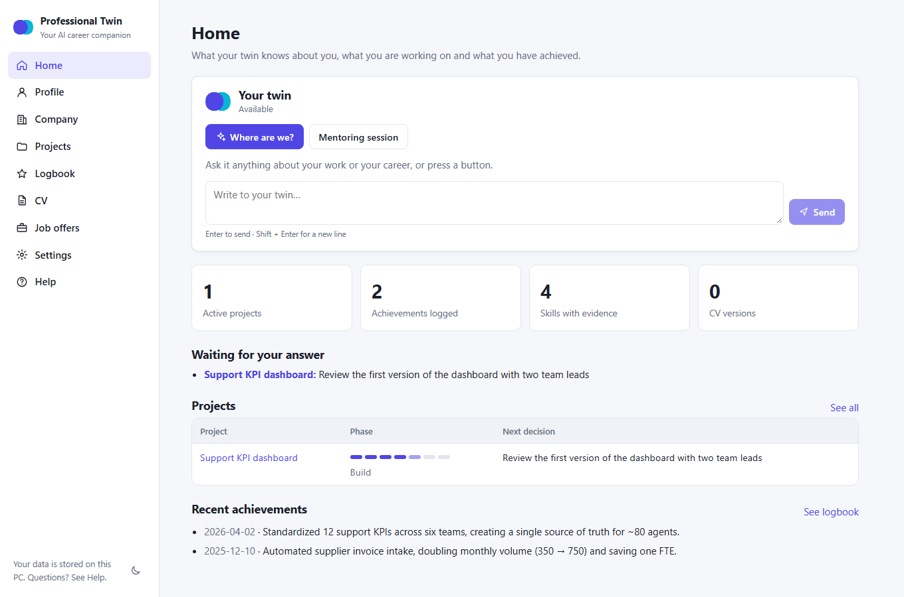
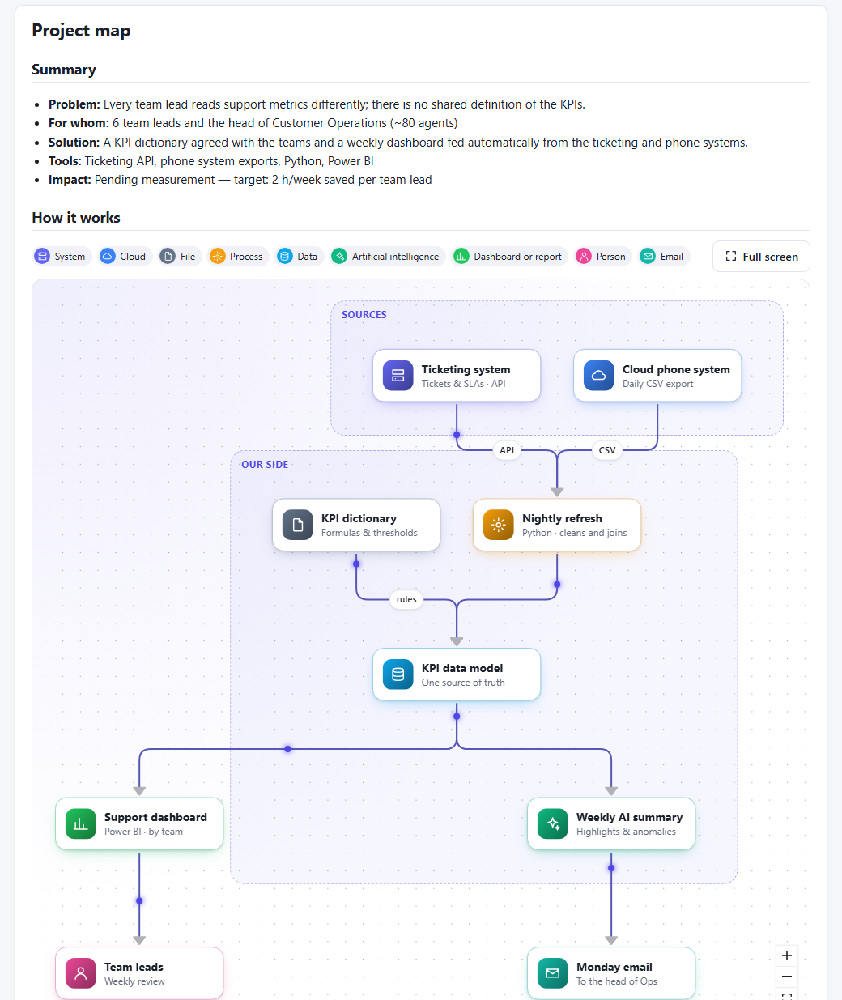
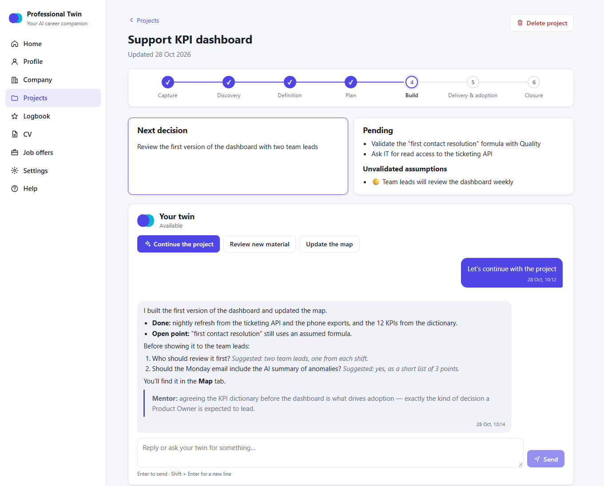
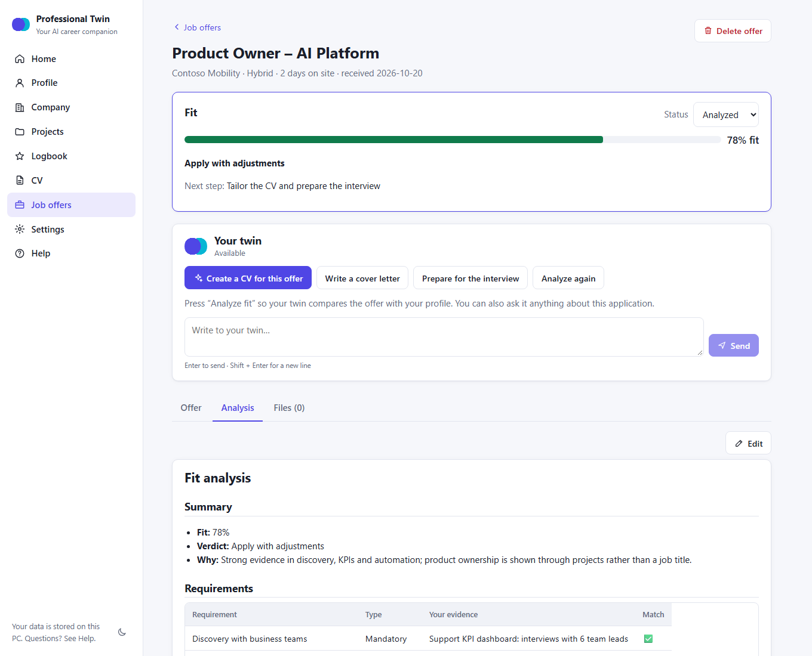
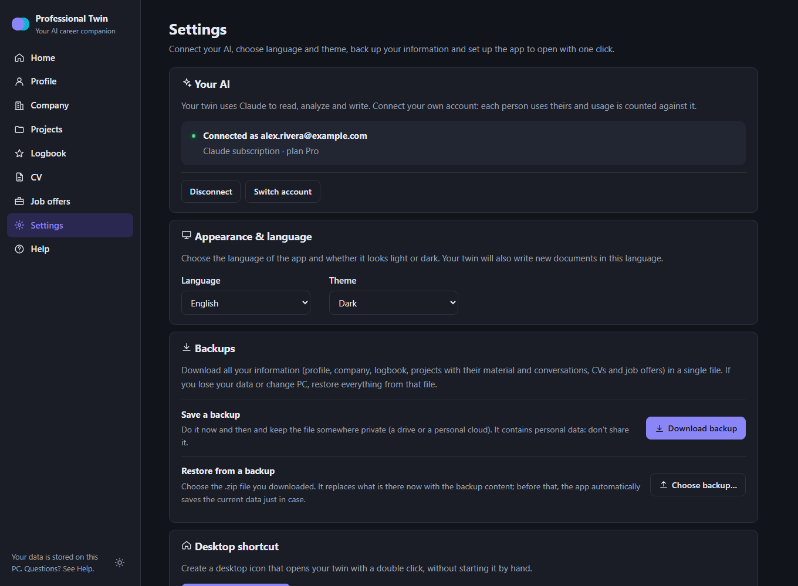
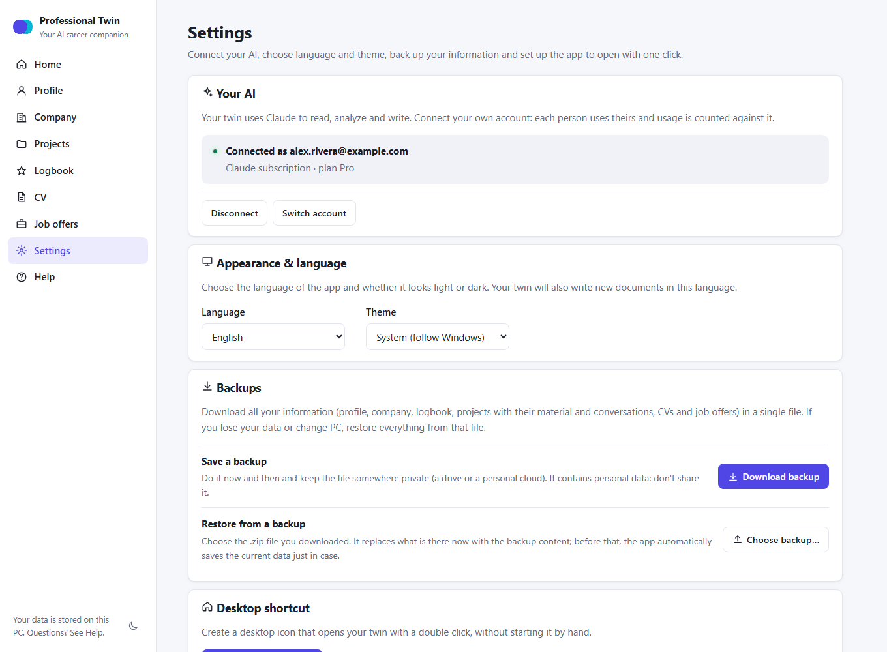

<div align="center">

# Professional Twin

**An AI-powered professional twin framework built on Claude Code.**

It knows your experience, applies your criteria and works with you from a business need to a delivered solution —
while it quietly turns everything you do into evidence for your CV and your career plan.

[](LICENSE)


[English](README.md) · [Español](README.es.md)

**▶ Interactive tour:** [maibp.github.io/professional-twin](https://maibp.github.io/professional-twin/)

<a href='https://ko-fi.com/Z5V229ZZE4' target='_blank'></a>

</div>



---

## Table of contents

- [What it is](#what-it-is)
- [What it does](#what-it-does)
- [How it works](#how-it-works)
- [Privacy](#privacy)
- [Requirements](#requirements)
- [Install](#install)
- [Connect your AI (Claude Code)](#connect-your-ai-claude-code)
- [Daily use](#daily-use)
- [Using it from the terminal](#using-it-from-the-terminal)
- [Backups](#backups)
- [Project structure](#project-structure)
- [Customize and extend](#customize-and-extend)
- [Contributing](#contributing) · [License](#license) · [Support](#support-the-project)

## What it is

Professional Twin is a private, local-first workspace that turns [Claude Code](https://claude.com/claude-code) into **your professional twin**. It plays three roles at once:

| Role | What it does for you |
|---|---|
| 🤝 **Co-worker** | Analyses needs, plans, documents, builds prototypes, code, dashboards and presentations. |
| 🧭 **Mentor** | Challenges your ideas with good practices, flags risks and shows how someone one level above would do it. |
| 📝 **Career chronicler** | Logs every achievement with evidence, so your CV and career plan build themselves. |

It comes with a friendly **web app** for non-technical people: no commands, no prompts to write — just buttons, forms and a chat. Power users can drive the very same twin from the terminal.

## What it does

- **Profile from your CV.** Upload your CV and certificates; the twin reads them and fills in your profile, working style and career goals with a short interview.
- **From business need to product.** Describe a problem in your own words. The twin opens a project and walks it through seven phases — asking the questions a good consultant would ask, proposing a solution, and building it with you. Nothing moves forward without your approval.
- **Document past work.** Point it at a folder (or upload files) of something you already delivered; it analyses the material and builds the project's map and portfolio entry.
- **Interactive project maps.** Every project gets a fact sheet and an interactive architecture diagram (zoom, click a piece to see its details, animated data flows), exportable to **PDF**.
- **Achievement log → CV.** Achievements are written as action + result, with skills, tools and evidence. Generate tailored CVs (Markdown + PDF) for a role or a specific job offer.
- **Job offers.** Paste an offer: you get a fit score, gaps, how to present yourself honestly, plus a tailored CV, cover letter and interview prep. Track each application's status.
- **Mentoring.** Career sessions that review progress against your target role and update your growth plan.
- **English or Spanish, light or dark.** Switch both from *Settings*.

<table>
<tr>
<td width="50%"><br><sub><b>Project map</b> — fact sheet + interactive diagram</sub></td>
<td width="50%"><br><sub><b>Your twin</b> — buttons and chat, live progress</sub></td>
</tr>
<tr>
<td width="50%"><br><sub><b>Job offers</b> — fit, gaps and a tailored application</sub></td>
<td width="50%"><br><sub><b>Settings</b> — your AI, language & theme (dark mode), backups</sub></td>
</tr>
</table>

## How it works

The twin has two halves that work on **the same plain Markdown files** on your computer:

- **The brain — Claude Code.** It understands, asks, proposes, builds and logs. Its identity and method live in [`CLAUDE.md`](CLAUDE.md) and its abilities in [`.claude/skills/`](.claude/skills).
- **The window — a local web app.** It shows your profile, projects, log and CVs, lets you upload and edit with forms, and runs the brain for you in the background when you press a button or chat.

<picture>
  <source media="(prefers-color-scheme: dark)" srcset="docs/images/how-it-works-dark.svg">
  
</picture>

### A project's journey

<picture>
  <source media="(prefers-color-scheme: dark)" srcset="docs/images/journey-dark.svg">
  
</picture>

### What happens when you press a button

<picture>
  <source media="(prefers-color-scheme: dark)" srcset="docs/images/what-happens-dark.svg">
  
</picture>

## Privacy

Privacy is a design principle, not an add-on.

<picture>
  <source media="(prefers-color-scheme: dark)" srcset="docs/images/privacy-dark.svg">
  
</picture>

- **Your content never goes to git.** The private folders are in `.gitignore`; the code you clone contains only empty templates.
- **Local-only server.** The app listens on `127.0.0.1` (not reachable from other machines), only reads and writes inside your private folders, and requires a custom header for every write.
- **What reaches the AI.** When the twin works on a task, Claude Code sends the content it needs to read to Claude (Anthropic) for processing — the same as using Claude directly — **under your own account and its terms**. Before uploading company material, remove personal data of customers or employees that isn't needed.
- **No credentials stored by the app.** Signing in is handled by Claude Code itself.
- **Bring your own account.** If your Claude account belongs to your employer, consider connecting a personal one for career content (CV, job offers).
- **Guard-rails for the twin.** It never invents achievements, figures or certifications, doesn't run scripts found in your material, and leaves out unnecessary personal data in deliverables meant for others.

## Requirements

| Tool | Why | Get it |
|---|---|---|
| **Node.js 20+** | Runs the local app | [nodejs.org](https://nodejs.org) |
| **Git** | Download the project (or download the ZIP from GitHub) | [git-scm.com](https://git-scm.com) |
| **Claude Code** | The twin's brain | [claude.com/claude-code](https://claude.com/claude-code) |
| **A Claude account** | Claude Pro, Max, Team or Enterprise subscription, *or* an Anthropic Console account (pay as you go) | [claude.ai](https://claude.ai) · [console.anthropic.com](https://console.anthropic.com) |
| **Microsoft Edge or Google Chrome** | PDF export of CVs and project maps | usually pre-installed |

Works on Windows (desktop shortcut included), macOS and Linux.

## Install

```bash
git clone https://github.com/MaiBP/professional-twin.git
cd professional-twin
npm install
npm run init          # creates your private folders from the templates (never overwrites)
npm start             # builds the UI and opens the app at http://localhost:3210
```

**Windows, no terminal:** double-click `start.bat`. Then, in the app, go to **Settings → Desktop shortcut** to get a *Professional Twin* icon on your desktop that starts the app with a double click.

## Connect your AI (Claude Code)

1. Install Claude Code ([instructions](https://claude.com/claude-code)).
2. Open the app → **Settings → Your AI** → **Connect**.
3. Choose *Claude subscription* or *Anthropic Console*. A Claude page opens in your browser: sign in, authorize, copy the code it shows and paste it into the app.

That's it: the status turns green and every button of the twin is enabled. You can **switch account** or **disconnect** from the same place. Each task uses your account's usage (a quick answer costs cents; documenting a large project costs more).



> Prefer the terminal? `claude auth login` does the same, and `claude auth status` shows who is connected.

## Daily use

1. **First time** — *Profile → CV and certificates*: upload your CV and press *Complete or update my profile*. Answer the twin's short interview.
2. **A new need** — *Projects → Describe a need*: tell it the problem in your own words. It answers with what it understood and a first batch of questions, each with a suggested answer — reply `ok` or correct.
3. **Past work** — *Projects → Document a finished project*: give it the folder path(s) or upload files and press *Create and analyze*.
4. **Keep going** — press *Continue the project*; approve each phase. Check the **Map** tab (and download it as PDF).
5. **Career** — achievements land in the **Logbook** automatically; create CVs in **CV**; paste job offers in **Job offers**; ask for a mentoring session in **Profile**.

The twin asks in batches of 3–6 questions, always with a suggested answer, distinguishes what it knows, assumes and is missing — and never closes a phase without your explicit approval.

## Using it from the terminal

Everything the app does can be done with Claude Code directly. Open a terminal **in the project folder** (so `CLAUDE.md` and the skills load) and run:

```bash
cd professional-twin
claude
```

| Command | What it does |
|---|---|
| `/onboarding` | Build or update your profile from your CV, certificates and company context |
| `/need <description>` | Capture a business need and open a project |
| `/document <project or folder>` | Add an already-finished project (retrospective) with its map |
| `/advance` | Move the active project to its next step or phase |
| `/log <what you did>` | Log an achievement by hand |
| `/mentor` | Career mentoring session and growth-plan review |
| `/cv <role or offer>` | Generate a tailored CV (Markdown + PDF) |
| `/offer <offer text or link>` | Analyse a job offer and prepare CV, letter and interview |
| `/status` | Summary of projects, pending decisions and recent achievements |

You don't always need commands — talk to it normally and it applies the same method.

Useful npm scripts:

| Script | Purpose |
|---|---|
| `npm start` | Build the UI and start the app on http://localhost:3210 |
| `npm run open` | Start the app in the background if needed and open the browser |
| `npm run dev` | Development mode with hot reload |
| `npm run init` | Create missing private files from the templates |
| `npm run pdf -- <file.md>` | Convert a Markdown file (CV, letter) into a clean PDF |

## Backups

Your content lives only on your PC, so back it up. **Settings → Backups → Download backup** gives you a single `.zip` with everything (profile, company, log, projects with their material and chats, CVs, offers) and a `README` inside explaining how to restore it.

To recover (after data loss or on a new PC): **Settings → Restore from a backup**, pick the `.zip` and confirm. Before replacing anything the app keeps an automatic copy of the current state, so a restore can be undone. Store backups somewhere private — they contain personal data.

## Project structure

```
app/server/        local API (Express): files, twin runner, settings, backups, PDF
app/client/        web UI (React + Vite); sections registered in src/sections.jsx
.claude/skills/    the twin's abilities (one folder per command)
templates/en|es/   empty templates in English and Spanish
scripts/           init, open the app, Markdown → PDF
docs/              README images and the interactive tour (GitHub Pages)
CLAUDE.md          the twin's identity, method and rules
start.bat          Windows launcher

profile/ context/ journal/ projects/ cv/ offers/ backups/ settings.json   ← private, git-ignored
```

## Customize and extend

- **Too many or too few questions?** Edit *How to ask* in `CLAUDE.md`.
- **Different phases or documents?** Edit `templates/<lang>/project/` and `.claude/skills/advance/SKILL.md`. If you change the format of `status.md`, `achievements.md`, `offer.md` or the ```map block in `map.md`, review `app/server/parsers.mjs`.
- **A new ability:** add `.claude/skills/<name>/SKILL.md`, its action in `app/server/twin.mjs` and the page's twin panel, plus an entry in `app/client/src/commands.js`.
- **The interactive tour and diagrams:** GitHub Pages serves the site from the `/docs` folder of the main branch (`docs/index.html`); the README diagrams are the SVGs in `docs/images/`.
- **A new section:** create the page in `app/client/src/` and register it in `app/client/src/sections.jsx` — it appears in the menu automatically.
- **Use it for someone else:** clone, `npm install`, `npm run init`, connect their own Claude account. No one's content travels with the code.

## Contributing

Issues and pull requests are welcome. Please never include personal content (anything from the private folders) in issues, screenshots or PRs.

## License

[MIT](LICENSE) © 2026 Maira Pajaro

## Support the project

If Professional Twin helps you grow your career, you can buy me a coffee ☕

<a href='https://ko-fi.com/Z5V229ZZE4' target='_blank'></a>

<sub>Professional Twin is an independent open-source project and is not affiliated with or endorsed by Anthropic. Claude and Claude Code are products of Anthropic.</sub>
